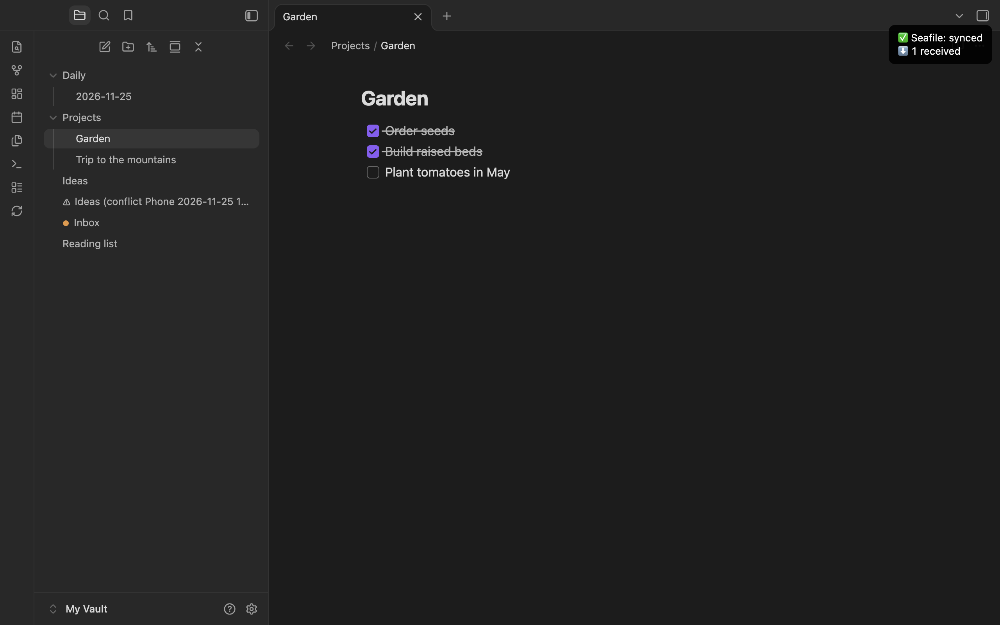
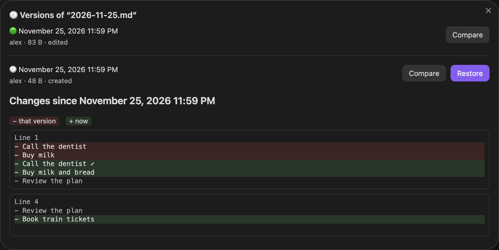
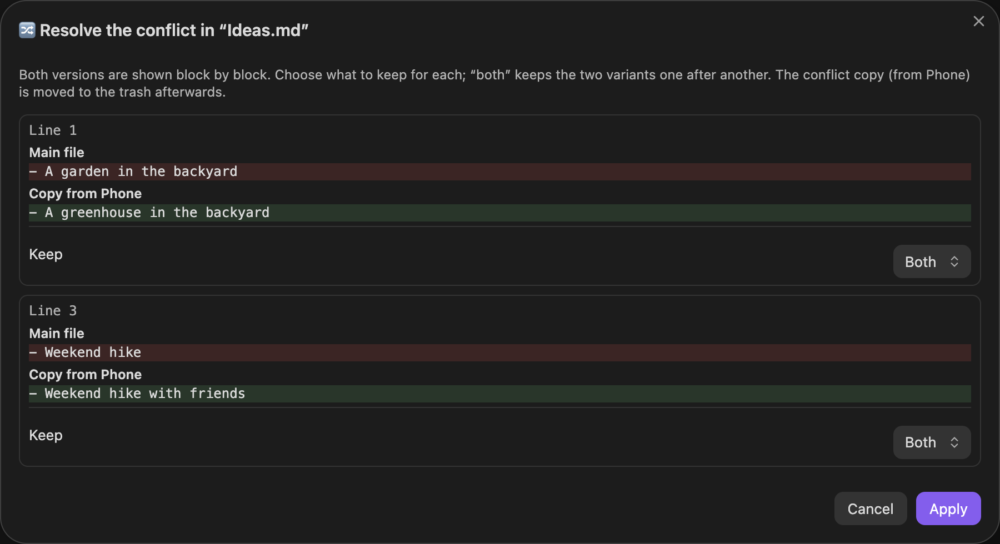
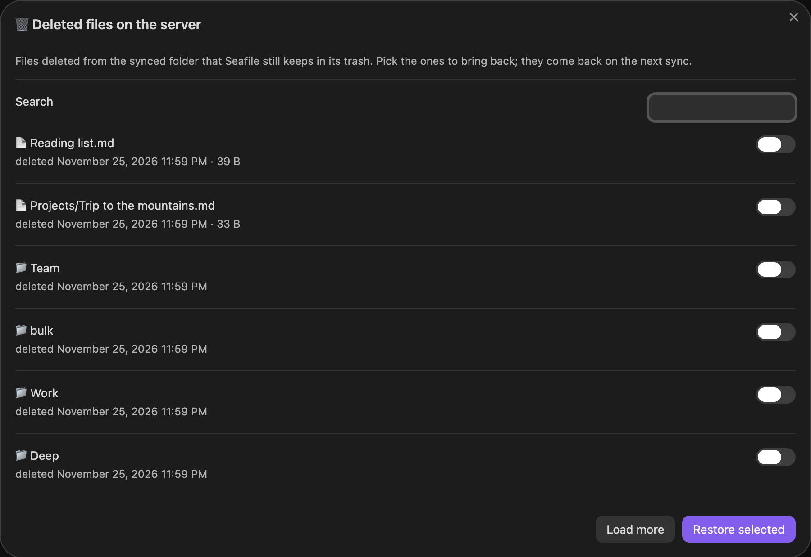
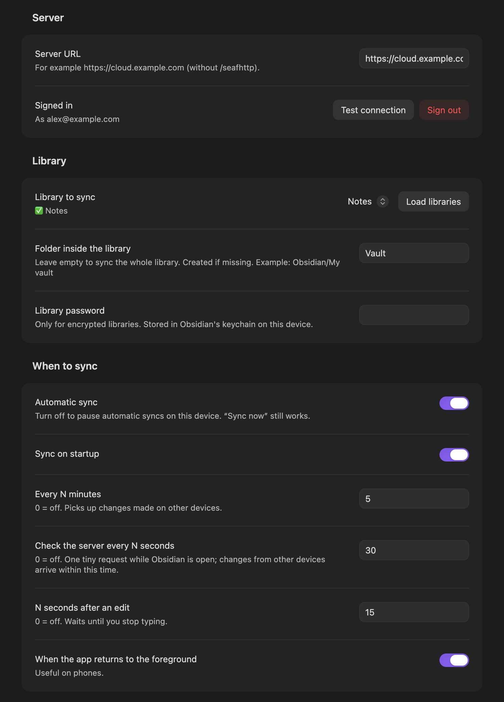
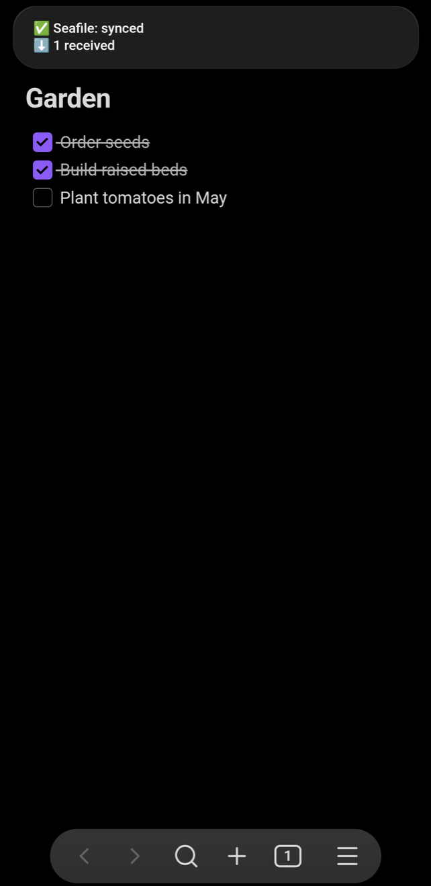
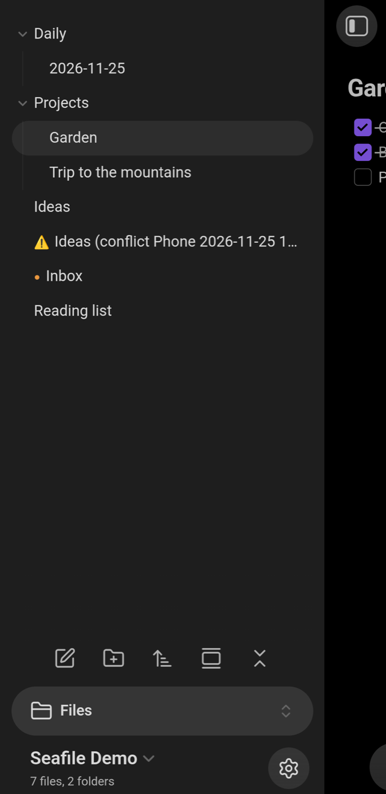
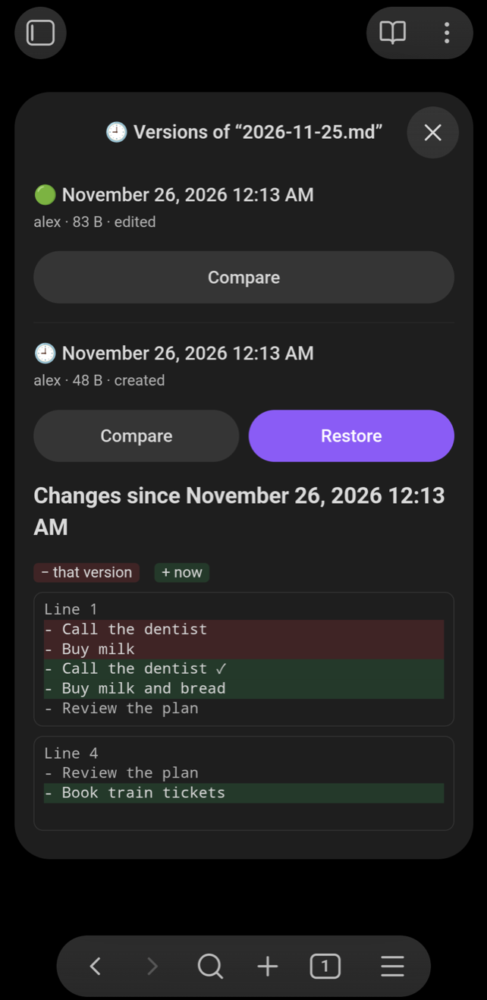

<div align="center">

# ☁️ Seafile Vault Sync

**Sync your Obsidian vault through your own Seafile server: on your computer and on your phone.**

[](https://github.com/grissspy/obsidian-seafile-sync/releases/latest)
[](https://github.com/grissspy/obsidian-seafile-sync/releases)
[](https://github.com/grissspy/obsidian-seafile-sync/actions/workflows/e2e.yml)
[](LICENSE)

Windows · macOS · Linux · Android · iOS

[Русская версия](README.ru.md)



</div>

## ✨ Why this plugin

- 🔁 **Two-way sync** with any Seafile library or a folder inside one. No Seafile desktop client needed.
- 🔀 **Edits from several devices are merged**, Excalidraw drawings too. If two edits hit the same line, both versions are kept. Nothing is silently overwritten.
- ⚡ **Almost real time.** Changes from other devices arrive in 10–40 seconds while Obsidian is open.
- 🛡️ **Safe by design.** It asks before deleting many files, keeps conflict copies, and moves deleted files to the trash.
- 🕘 **Version history, trash and a conflict helper** right inside Obsidian.
- 📱 **Phone-friendly.** Wi-Fi-only mode; choose which folders and file types to keep on each device.
- 🔐 **Private.** It talks only to your server, keeps the login in Obsidian's keychain, and has no telemetry.

## 📸 A closer look

| Version history | Conflict helper |
|---|---|
|  |  |
| Compare any version from the server with the current note and restore it in one click. | When two devices changed the same lines, pick block by block what to keep. |

| Deleted files | Settings |
|---|---|
|  |  |
| Bring back files deleted on any device from the Seafile trash. | Everything is explained in plain words and set up in a minute. |

**On a phone**

| Note | File list | History |
|---|---|---|
|  |  |  |

## 🚀 Install

**From Obsidian** (recommended): *Settings → Community plugins → Browse*, search for **Seafile Vault Sync**, then **Install** and **Enable**.

<details>
<summary>Other ways: BRAT or manual install</summary>

- **BRAT** (beta versions, auto-updates): install the BRAT plugin → *Add beta plugin* → `grissspy/obsidian-seafile-sync`.
- **Manual:** download `main.js`, `manifest.json` and `styles.css` from the [latest release](https://github.com/grissspy/obsidian-seafile-sync/releases/latest), put them into `<vault>/.obsidian/plugins/seafile-vault-sync/`, restart Obsidian and enable the plugin. On phones the `.obsidian` folder is hidden; copy the files with a file manager or over USB.

</details>

## ⚙️ Set up in a minute

1. Open *Settings → Seafile Vault Sync* and enter your **server address**, e.g. `https://cloud.example.com`.
2. Enter your login and password and press **Sign in**. The password is used once and never stored.
3. Press **Load libraries** and pick a library. You can also enter a folder inside it, for example `Obsidian/My vault`.
4. Press the ⟳ icon. Done. Repeat on your other devices with the same library and folder.

> [!TIP]
> A new phone can start with an empty vault: the plugin downloads everything. On a device that already has the same files, the first sync compares them by content, so nothing is duplicated.

## 🔄 How it syncs

The plugin remembers the last successful sync. For every file it compares three versions: this device, the server and the last sync.

| This device | Server | What happens |
|---|---|---|
| changed | — | uploaded |
| — | changed | downloaded |
| changed | changed | notes are **merged**; if the same lines were edited, both versions are kept as `Note (conflict Phone 2026-11-25 140312).md` |
| deleted | — | deleted on the server (it goes to the Seafile trash) |
| — | deleted | moved to the trash on this device |
| deleted | changed | the edit wins, the file comes back |

A sync runs on startup, every few minutes, a few seconds after you stop typing, when the server reports a change, and when you return to the app on a phone. You can also press ⟳, click the status bar, or run **Sync now**.

<details>
<summary>More details</summary>

- Changes are detected by content (SHA-256). A file that was only touched is not uploaded again.
- When nothing changed, a sync is a single small request.
- Before overwriting anything, the plugin checks again that neither you nor another device changed the file in the meantime. A late change becomes a merge instead of being lost.
- If one sync would delete more than N files (20 by default), it asks: delete, restore, or not now.
- Open notes refresh in the editor. Empty folders are synced too.
- Encrypted libraries and two-factor sign-in are supported.
- Live co-editing (seeing someone else type) is not possible with Seafile; simultaneous edits are merged instead.

</details>

## 🧰 Tools

| | |
|---|---|
| 🕘 **Version history** | Right-click a file → *Seafile: version history*. Compare and restore; the current version stays in the history. |
| ♻️ **Restore deleted files** | *Settings → Tools → Open trash*, or the command *Restore deleted files from the server trash*. |
| 🔀 **Resolve a conflict** | Right-click a note that has a `(conflict …)` copy → *Seafile: resolve conflict*. |
| 🟠 **Status in the file list** | An orange dot marks files not synced yet, ⚠️ marks conflict copies. |
| 🔗 **Share link** | Right-click → *Seafile: copy share link* (a view-only Seafile link). |
| 📂 **Only some folders on this device** | Keep big attachments off your phone. Nothing is deleted anywhere. |
| 📚 **More libraries** | Sync a vault folder with another library, e.g. a shared team library. |
| 📱 **Copy settings to a new device** | *Settings → Tools → Save to server*, then *Copy from a device…* on the new one. |

## 💻 Platforms and compatibility

| | Status | How it is tested |
|---|---|---|
| 🪟 Windows | ✅ | automatic test in the real Obsidian app on every change ([E2E](https://github.com/grissspy/obsidian-seafile-sync/actions/workflows/e2e.yml)) |
| 🍎 macOS | ✅ | automatic test in the real app, plus tests with a real Seafile server |
| 🐧 Linux | ✅ | automatic test in the real Obsidian app |
| 🤖 Android | ✅ | the same test suite on a real phone (Android 17), plus real-server tests |
| 📱 iOS / iPadOS | 🟡 | uses only the cross-platform Obsidian APIs that work on Android, but has not been tested on a device yet; feedback is welcome |

- **Obsidian** 1.13.0 or newer (tested on 1.15).
- **Seafile Server** 7.0 or newer, Community or Pro (tested on 11.0.13 CE). The plugin warns you if the server is older.

**Other plugins.** It works alongside other plugins: it reads and writes vault files through Obsidian's own API and saves an open editor before touching its file. Plugins that edit notes (Linter, Templater…) are just regular edits. **Excalidraw** drawings (`.excalidraw.md` and `.excalidraw`) get a merge of their own: if one drawing is changed on two devices at once, the plugin combines them shape by shape, the way Excalidraw's live collaboration does. Shapes added on either device are kept, the newer edit of a shape wins, and deletions carry over. If a drawing can't be read, both versions are kept. Their exported PNG/SVG files sync as images. Syncing *other plugins' settings* is off by default and can be turned on part by part.

> [!WARNING]
> **Don't sync the same files twice.** Don't use this plugin together with another sync for the same vault (Obsidian Sync, Remotely Save, an auto-pushing Git plugin, or the Seafile desktop client on the same folder). Changes would bounce back and forth.

## 🔐 Security and privacy

- The plugin connects **only** to the Seafile server you enter. No telemetry, no third-party services.
- Your password is used once to get an access token and is never stored. The token and the library password are kept in **Obsidian's keychain** on each device, never in the vault or in synced settings.
- Use `https://`. The settings warn you about plain `http://`.
- To compare your vault with the server, the plugin reads the files in your vault. Their contents go only to your server.
- Paths from the server are checked, so a broken or hostile server can't write outside your vault.
- Syncing other plugins' **code** means that code runs on all your devices. Turn it on only if you trust everyone who can write to the library.
- Releases are built by GitHub Actions with [build provenance](https://github.com/grissspy/obsidian-seafile-sync/attestations), so you can check that `main.js` comes from this repository.

## ❓ Troubleshooting

<details>
<summary>Libraries load, but files don't upload or download</summary>

The server's `SERVICE_URL` / `FILE_SERVER_ROOT` is probably wrong. Turn on *Settings → Advanced → Use server URL for file transfers*.
</details>

<details>
<summary>“Your session has expired”</summary>

The token was revoked (for example, the password changed). Press *Sign out* and sign in again.
</details>

<details>
<summary>What happened during the last sync?</summary>

Run the command **Show sync log**, or open *Settings → Tools → Sync log*.
</details>

## 🛠️ Development

```bash
npm install
npm run dev      # rebuild on change
npm test         # sync engine tests against a fake Seafile server
npm run e2e -- --obsidian /path/to/Obsidian   # the real Obsidian app with an isolated profile
npm run build
```

To release, run `npm version patch && git push --follow-tags`; GitHub Actions builds and publishes it. Code layout: `src/sync.ts` (algorithm), `src/seafile.ts` (API client), `src/merge.ts` (three-way merge), `src/local.ts` (vault access), `src/ui.ts` (dialogs), `src/main.ts` (plugin).

## ☕ Support

If the plugin saves you time, you can support development on [Boosty](https://boosty.to/grispy/donate). Bug reports and ideas are welcome in [Issues](https://github.com/grissspy/obsidian-seafile-sync/issues).

License: [MIT](LICENSE).
