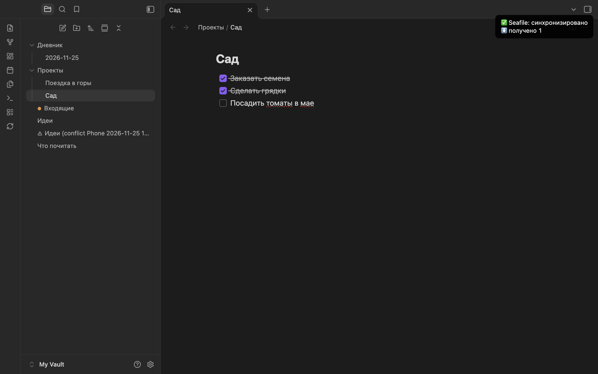
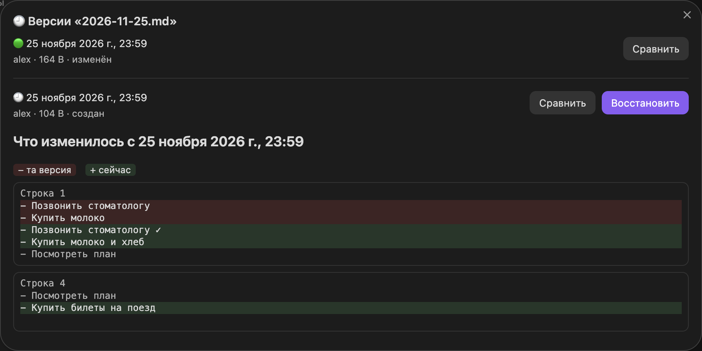
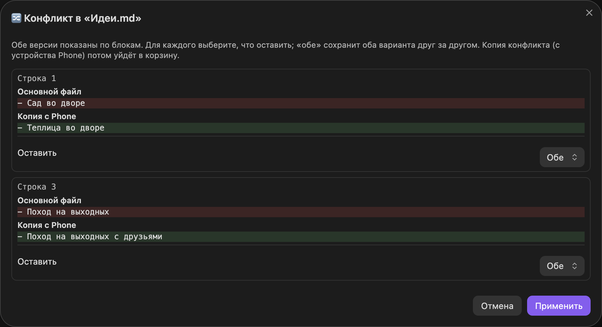
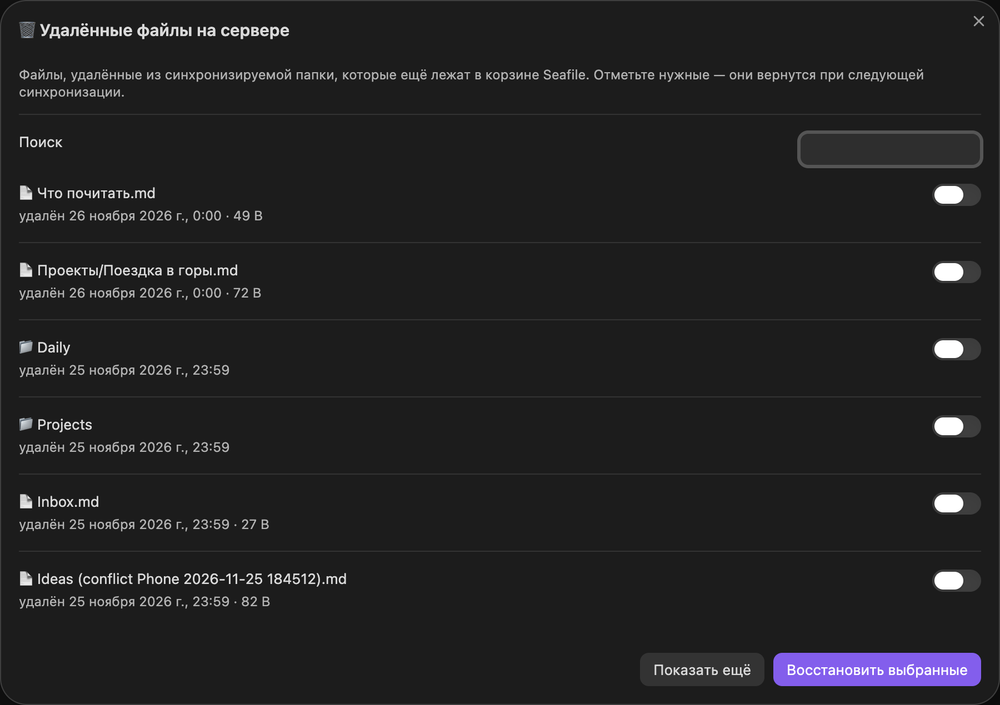
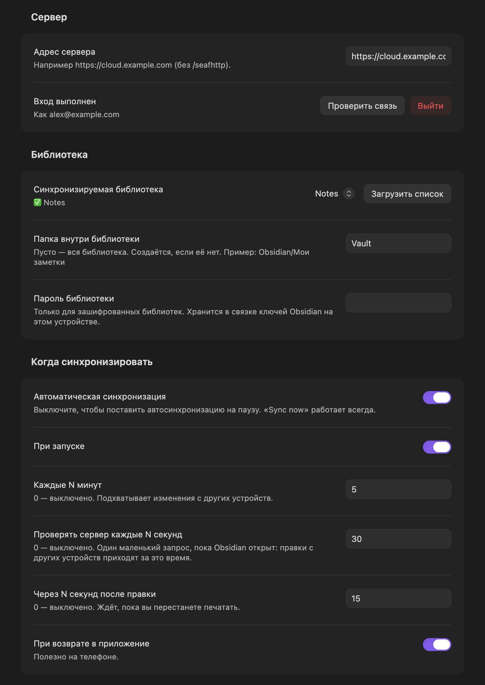
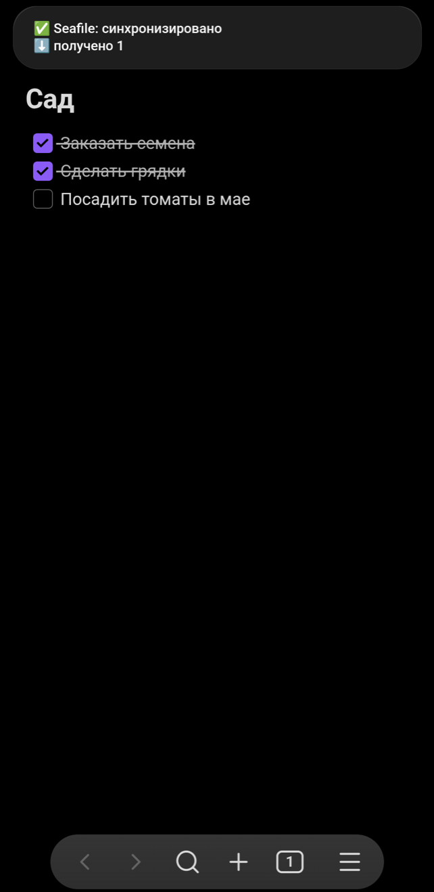
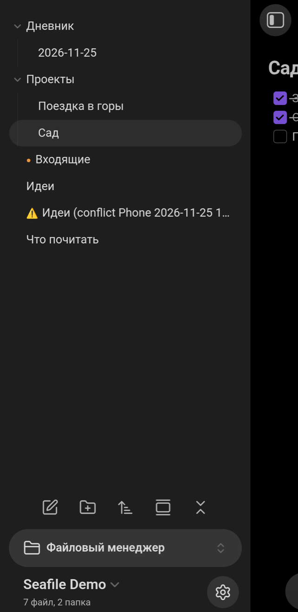
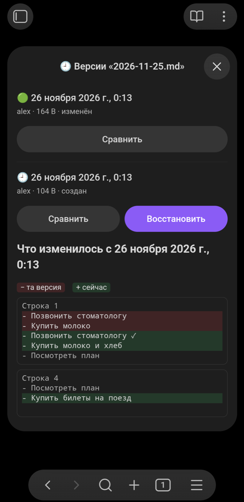

<div align="center">

# ☁️ Seafile Vault Sync

**Синхронизация хранилища Obsidian через ваш собственный сервер Seafile: на компьютере и на телефоне.**

[](https://github.com/grissspy/obsidian-seafile-sync/releases/latest)
[](https://github.com/grissspy/obsidian-seafile-sync/releases)
[](https://github.com/grissspy/obsidian-seafile-sync/actions/workflows/e2e.yml)
[](LICENSE)

Windows · macOS · Linux · Android · iOS

[English version](README.md)



</div>

## ✨ Чем он хорош

- 🔁 **Двусторонняя синхронизация** с любой библиотекой Seafile или папкой в ней. Десктопный клиент Seafile не нужен.
- 🔀 **Правки с разных устройств сливаются**, рисунки Excalidraw тоже. Если две правки попали в одну строку, сохраняются обе версии. Ничего не затирается молча.
- ⚡ **Почти в реальном времени.** Пока Obsidian открыт, изменения с других устройств приходят за 10–40 секунд.
- 🛡️ **Безопасно.** Спрашивает перед массовым удалением, сохраняет копии конфликтов, удалённое уходит в корзину.
- 🕘 **История версий, корзина и помощник по конфликтам** прямо в Obsidian.
- 📱 **Удобно на телефоне.** Режим «только по Wi-Fi», выбор папок и типов файлов для каждого устройства.
- 🔐 **Приватно.** Общается только с вашим сервером, вход хранится в связке ключей Obsidian, никакой телеметрии.

## 📸 Как это выглядит

| История версий | Помощник по конфликтам |
|---|---|
|  |  |
| Любую версию с сервера можно сравнить с текущей и восстановить в один клик. | Если два устройства изменили одни и те же строки, выберите по блокам, что оставить. |

| Удалённые файлы | Настройки |
|---|---|
|  |  |
| Файлы, удалённые на любом устройстве, возвращаются из корзины Seafile. | Всё объяснено простыми словами, настройка занимает минуту. |

**На телефоне**

| Заметка | Список файлов | История |
|---|---|---|
|  |  |  |

## 🚀 Установка

**Из Obsidian** (рекомендуется): *Settings → Community plugins → Browse*, найдите **Seafile Vault Sync**, нажмите **Install** и **Enable**.

<details>
<summary>Другие способы: BRAT или вручную</summary>

- **BRAT** (бета-версии с автообновлением): установите плагин BRAT → *Add beta plugin* → `grissspy/obsidian-seafile-sync`.
- **Вручную:** скачайте `main.js`, `manifest.json` и `styles.css` из [последнего релиза](https://github.com/grissspy/obsidian-seafile-sync/releases/latest), положите в `<хранилище>/.obsidian/plugins/seafile-vault-sync/`, перезапустите Obsidian и включите плагин. На телефоне папка `.obsidian` скрыта: скопируйте файлы файловым менеджером или по USB.

</details>

## ⚙️ Настройка за минуту

1. Откройте *Настройки → Seafile Vault Sync* и введите **адрес сервера**, например `https://cloud.example.com`.
2. Введите логин и пароль и нажмите **Войти**. Пароль нужен один раз и не сохраняется.
3. Нажмите **Загрузить список** и выберите библиотеку. Можно указать папку внутри неё, например `Obsidian/Мои заметки`.
4. Нажмите ⟳. Готово. На остальных устройствах сделайте то же с той же библиотекой и папкой.

> [!TIP]
> Хранилище на новом телефоне можно создать пустым: плагин сам всё скачает. Если на устройстве уже есть те же файлы, первая синхронизация сравнит их по содержимому, и дубликатов не будет.

## 🔄 Как синхронизирует

Плагин помнит последнюю успешную синхронизацию. Для каждого файла он сравнивает три версии: на этом устройстве, на сервере и с прошлой синхронизации.

| Это устройство | Сервер | Что происходит |
|---|---|---|
| изменён | — | отправляется на сервер |
| — | изменён | скачивается |
| изменён | изменён | заметки **сливаются**; если правили одни и те же строки, сохраняются обе версии: `Заметка (conflict Phone 2026-11-25 140312).md` |
| удалён | — | удаляется на сервере (попадает в корзину Seafile) |
| — | удалён | уходит в корзину на этом устройстве |
| удалён | изменён | правка побеждает, файл возвращается |

Синхронизация запускается при старте, каждые несколько минут, через несколько секунд после того, как вы перестали печатать, когда сервер сообщает об изменениях, и при возврате в приложение на телефоне. А ещё вручную: ⟳, клик по строке состояния или команда **Sync now**.

<details>
<summary>Подробнее</summary>

- Изменения определяются по содержимому (SHA-256). Файл, у которого изменилась только дата, повторно не отправляется.
- Если ничего не менялось, синхронизация занимает один маленький запрос.
- Перед любой перезаписью плагин ещё раз проверяет, что ни вы, ни другое устройство не изменили файл за это время. Поздняя правка сливается, а не теряется.
- Если за одну синхронизацию удалится больше N файлов (по умолчанию 20), плагин спросит: удалить, восстановить или не сейчас.
- Открытые заметки обновляются в редакторе. Пустые папки тоже синхронизируются.
- Поддерживаются зашифрованные библиотеки и вход с двухфакторной защитой.
- Совместного редактирования «вживую» (видеть, как печатает другой) в Seafile нет; одновременные правки вместо этого сливаются.

</details>

## 🧰 Инструменты

| | |
|---|---|
| 🕘 **История версий** | Правый клик по файлу → *Seafile: история версий*. Сравнение и восстановление; текущая версия остаётся в истории. |
| ♻️ **Восстановить удалённое** | *Настройки → Инструменты → Открыть корзину* или команда *Restore deleted files from the server trash*. |
| 🔀 **Решить конфликт** | Правый клик по заметке с копией `(conflict …)` → *Seafile: решить конфликт*. |
| 🟠 **Статус в списке файлов** | Оранжевая точка у ещё не синхронизированных файлов, ⚠️ у копий конфликтов. |
| 🔗 **Ссылка на файл** | Правый клик → *Seafile: скопировать ссылку* (ссылка Seafile только для просмотра). |
| 📂 **Только часть папок на устройстве** | Не держите тяжёлые вложения на телефоне. Ничего нигде не удаляется. |
| 📚 **Другие библиотеки** | Синхронизируйте папку хранилища с другой библиотекой, например с общей библиотекой команды. |
| 📱 **Настройки на новое устройство** | *Настройки → Инструменты → Сохранить на сервер*, а на новом устройстве *Скопировать с устройства…* |

## 💻 Платформы и совместимость

| | Статус | Как проверяется |
|---|---|---|
| 🪟 Windows | ✅ | автоматический тест в настоящем Obsidian при каждом изменении ([E2E](https://github.com/grissspy/obsidian-seafile-sync/actions/workflows/e2e.yml)) |
| 🍎 macOS | ✅ | автоматический тест в настоящем приложении и проверки с настоящим сервером Seafile |
| 🐧 Linux | ✅ | автоматический тест в настоящем Obsidian |
| 🤖 Android | ✅ | тот же набор тестов на настоящем телефоне (Android 17) и проверки с настоящим сервером |
| 📱 iOS / iPadOS | 🟡 | использует только те же кроссплатформенные API Obsidian, что работают на Android, но на устройстве пока не проверялся; будем рады отзывам |

- **Obsidian** 1.13.0 и новее (проверено на 1.15).
- **Seafile Server** 7.0 и новее, Community или Pro (проверено на 11.0.13 CE). Если сервер старше, плагин предупредит.

**Другие плагины.** Плагин уживается с другими плагинами: читает и пишет файлы хранилища через API самого Obsidian и сохраняет открытый редактор, прежде чем трогать его файл. Плагины, которые правят заметки (Linter, Templater…), для него обычные правки. Для рисунков **Excalidraw** (`.excalidraw.md` и `.excalidraw`) есть отдельное слияние: если один рисунок изменили на двух устройствах одновременно, плагин объединит их по фигурам, как это делает совместная работа в самом Excalidraw. Фигуры, добавленные на любом устройстве, сохраняются, у каждой фигуры побеждает более новая правка, удаления переносятся. Если рисунок не удаётся прочитать, сохраняются обе версии. Экспортированные PNG/SVG синхронизируются как картинки. Синхронизация *настроек других плагинов* по умолчанию выключена и включается по частям.

> [!WARNING]
> **Не синхронизируйте одни и те же файлы дважды.** Не используйте этот плагин вместе с другой синхронизацией того же хранилища (Obsidian Sync, Remotely Save, Git-плагин с автопушем или десктопный клиент Seafile на той же папке). Изменения будут ходить по кругу.

## 🔐 Безопасность и приватность

- Плагин обращается **только** к указанному вами серверу Seafile. Никакой телеметрии и сторонних сервисов.
- Пароль нужен один раз, чтобы получить токен доступа, и не сохраняется. Токен и пароль библиотеки хранятся в **связке ключей Obsidian** на каждом устройстве, а не в хранилище и не в синхронизируемых настройках.
- Используйте `https://`. Настройки предупредят про `http://`.
- Чтобы сравнивать хранилище с сервером, плагин читает файлы хранилища. Их содержимое уходит только на ваш сервер.
- Пути с сервера проверяются: сломанный или вредоносный сервер не сможет записать что-то за пределами хранилища.
- Если синхронизировать **код** других плагинов, он будет выполняться на всех ваших устройствах. Включайте, только если доверяете всем, кто может писать в библиотеку.
- Релизы собирает GitHub Actions с [подтверждением происхождения](https://github.com/grissspy/obsidian-seafile-sync/attestations): можно проверить, что `main.js` собран из этого репозитория.

## ❓ Если что-то не так

<details>
<summary>Список библиотек открывается, а файлы не передаются</summary>

На сервере, скорее всего, неверно задан `SERVICE_URL` / `FILE_SERVER_ROOT`. Включите *Настройки → Дополнительно → Передавать файлы через адрес сервера*.
</details>

<details>
<summary>«Сессия истекла»</summary>

Токен отозван (например, сменился пароль). Нажмите *Выйти* и войдите снова.
</details>

<details>
<summary>Что произошло при последней синхронизации?</summary>

Команда **Show sync log** или *Настройки → Инструменты → Журнал синхронизации*.
</details>

## 🛠️ Разработка

```bash
npm install
npm run dev      # пересборка при изменениях
npm test         # тесты синхронизации на имитации сервера Seafile
npm run e2e -- --obsidian /путь/к/Obsidian   # настоящий Obsidian с отдельным профилем
npm run build
```

Выпуск версии: `npm version patch && git push --follow-tags`, остальное сделает GitHub Actions. Код: `src/sync.ts` — алгоритм, `src/seafile.ts` — клиент API, `src/merge.ts` — трёхстороннее слияние, `src/local.ts` — работа с хранилищем, `src/ui.ts` — окна, `src/main.ts` — плагин.

## ☕ Поддержать

Если плагин экономит вам время, можно поддержать разработку на [Boosty](https://boosty.to/grispy/donate). Ошибки и идеи — в [Issues](https://github.com/grissspy/obsidian-seafile-sync/issues).

Лицензия: [MIT](LICENSE).
